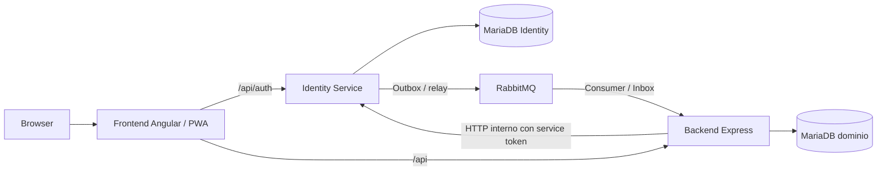

# Diagramma architetturale

Il diagramma mostra i componenti applicativi di HackHub e le comunicazioni tra frontend, backend, Identity, database e broker.

Il backend comprende i moduli Team, Hackathon, Competition, Support e Notification. Identity gestisce autenticazione e utenti nel proprio database. Per il flusso asincrono, i retry e la dead-letter queue, consultare [Messaggistica](messaggistica.md).