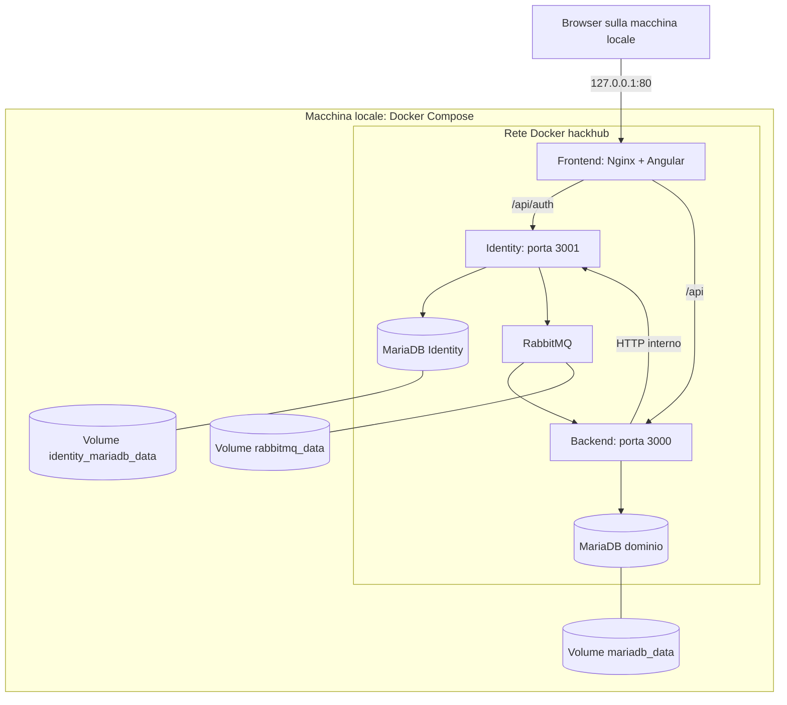

# Diagramma deployment

Il diagramma rappresenta il deployment locale con Docker Compose, la rete tra i servizi e i volumi persistenti.

La porta frontend predefinita è `80` e può essere modificata con `FRONTEND_PORT`. Le porte dei database e di RabbitMQ sono pubblicate solo su `127.0.0.1`; backend e Identity comunicano sulla rete Docker. Per configurazione e comandi di avvio consultare il [README principale](../README.md#avvio-locale-con-docker-compose).