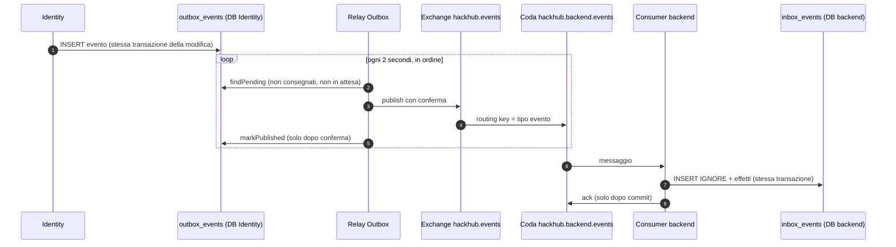

# Messaggistica: Outbox → RabbitMQ → Inbox

Gli eventi di dominio passano da Identity al backend tramite RabbitMQ. Il pattern Outbox garantisce che un evento venga registrato nella stessa transazione della modifica che lo produce; il pattern Inbox garantisce che il backend applichi ogni evento una sola volta anche se viene consegnato più volte.

## Flusso

## Topologia

| Risorsa | Tipo | Ruolo |
|---|---|---|
| `hackhub.events` | topic | Eventi pubblicati da Identity |
| `hackhub.backend.events` | coda | Coda del backend, legata a `hackhub.events` con `#` |
| `hackhub.events.retry` | direct | Instrada i retry sulla coda di attesa, con chiave = ritardo in ms |
| `hackhub.backend.events.retry.<N>ms` | coda con TTL | Attende N ms, poi dead-letter verso `hackhub.events` con la chiave originale |
| `hackhub.events.dead` | fanout | Riceve i messaggi esauriti o malformati |
| `hackhub.backend.events.dead` | coda | Dead-letter queue, con `x-attempts` e `x-last-error` |

Ogni ritardo ha la sua coda con TTL (1s, 2s, 4s, 8s, 16s): un evento in attesa non blocca gli altri.

## Retry e dead-letter

- **Consumer**: se un handler fallisce, il messaggio viene ripubblicato su `hackhub.events.retry` con `x-attempts` incrementato, e il messaggio originale viene confermato (ack). Dopo cinque retry, o per un messaggio malformato, la copia va in `hackhub.backend.events.dead`. Il consumer fa ack solo dopo il commit dell'Inbox o dopo la conferma di RabbitMQ della copia di retry o dead-letter.
- **Relay**: se la pubblicazione fallisce, la riga resta in `outbox_events` con `attempts` incrementato, `last_error` e `next_attempt_at` nel futuro, con le stesse attese. Dopo cinque retry viene marcata `dead_lettered_at`, e il relay prosegue con gli eventi successivi.

## Garanzie

- **Consegna**: *at-least-once*. Un crash tra la conferma della pubblicazione e `markPublished`, o tra il commit dell'Inbox e l'ack, provoca una nuova consegna.
- **Idempotenza**: `inbox_events` ha chiave `event_id`. Il backend inserisce la riga con `INSERT IGNORE` nella stessa transazione dei suoi effetti: un duplicato non produce effetti.
- **Ordine**: il relay pubblica in ordine e un evento in attesa blocca quelli successivi. Un retry nel consumer può far arrivare un evento dopo quelli successivi: il backend non deve dipendere dall'ordine tra eventi diversi.
- **Non è exactly-once**: né il broker né il database la garantiscono; l'effetto unico si ottiene con l'Inbox idempotente.

## Nota sui binding

RabbitMQ ignora gli argomenti di un binding su exchange `headers` le cui chiavi iniziano con `x-`. Un binding con `x-retry-delay` corrispondeva quindi a qualunque messaggio, e ogni retry veniva copiato in tutte le code di attesa. Per questo il retry usa un exchange `direct` con chiave uguale al ritardo.
